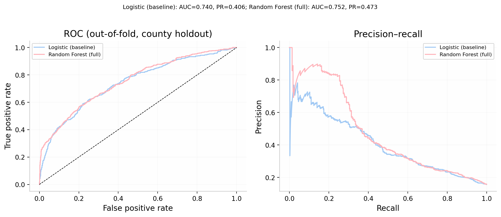

# Wildfire, Environmental Disturbance, and H5N1 Surveillance

**Independent ML prototype | Python · scikit-learn · lagged environmental features · county-grouped validation**

A reproducible modeling prototype exploring how environmental disturbance
variables could be evaluated alongside climate and landscape predictors of
wild-bird disease detections. It complements my
[doctoral disease-ecology analysis](https://github.com/infectiousvibes/california-hpai-dissertation-code)
by developing a prediction-focused workflow with nonlinear models and
geographically grouped evaluation.

**Current status: the executed notebooks, committed panel, figures, and metrics
use synthetic data.** They demonstrate the modeling workflow and are not
findings about actual wildfire effects, H5N1 occurrence, or operational disease
risk. The real-data acquisition and panel-assembly workflow is incomplete.

## Research motivation

Land-use conditions, seasonal climate, and environmental disturbances may
influence the wildlife–agriculture interface. This prototype turns that
research question into an explicit county-month modeling design: do lagged
fire activity, vegetation anomalies, and land-surface temperature provide
useful predictive information for a surveillance outcome?

The intended observational outcome is at least one reported H5N1 wild-bird
detection in a county-month. Reported detections depend on surveillance and
sampling, so they would not directly measure infection prevalence. The current
synthetic dataset lets the model and evaluation code run without source-data
credentials or downloads.

## Observed fire detections available

[SNPP VIIRS 375 m fire detections for July–October 2025](data/processed/viirs_snpp_375m_202507_202510/README.md)
are available as four monthly CSVs: **28,824 detections** extracted from 707
NASA VNP14IMG Collection 002 granules. The data include coordinates, fire
radiative power, detection confidence, and source-granule identifiers.
The California bounding box includes areas outside the state. July 5–7 has
no matching source swaths and is documented as missing observation coverage.

The [interactive Earthdata downloader](scripts/download_viirs_snpp.py) preserves
the original NetCDF files in the Git-ignored `data/raw/` directory. Source
URLs, checksums, daily catalog coverage, and validation results accompany the
committed CSVs. These observations are a separate input dataset; the executed
notebooks and model results still use synthetic data.

## Skills demonstrated in the working code

| Capability | Implementation |
| --- | --- |
| Reproducible panel construction | [Seeded synthetic generator](src/synthetic.py): 58 named counties × 48 months (2022–2025), with explicit county heterogeneity and a planted disturbance signal |
| Temporal feature engineering | One-month within-county disturbance lags, log transforms, cyclic seasonality, and reusable [design-matrix helpers](src/features.py) |
| ML benchmarking | [Scaled logistic regression and class-balanced random forest](src/models.py) with fixed seeds and reusable model functions |
| Geographic generalization assessment | Five-fold `GroupKFold` by county; each test fold contains counties excluded from its training fold |
| Evaluation and uncertainty | Pooled out-of-fold ROC-AUC, average precision, precision/recall/F1, and [bootstrap interval helpers](src/evaluate.py) |
| Model interpretation and communication | [Permutation importance, ROC/precision–recall curves, temporal plots, and illustrative probability maps](src/viz.py) |

This is a tabular ML workflow with spatial grouping. Grouping by county tests
transfer to held-out counties; it does not provide a forward-in-time forecasting
test or separate neighboring counties with a spatial buffer.

## What is implemented, and what remains

| Component | Status |
| --- | --- |
| Synthetic panel, feature engineering, model fitting, and figure generation | Implemented and demonstrated in four executed notebooks |
| APHIS CSV aggregation and FIRMS point-to-county aggregation | Helper functions are present; not a completed real-data analysis |
| MODIS, PRISM, and CDL acquisition / raster processing | Outlined; relevant functions currently raise `NotImplementedError` |
| Integrated real-data panel | Not implemented; notebook 01 stops in real-data mode |
| Real-data validation, feature-set ablation, calibration, and dashboard deployment | Future work |

The environmental sources proposed for a real-data extension are APHIS
surveillance, NASA FIRMS fire detections, MODIS NDVI/LST, PRISM climate, USDA
CDL land cover, and Census boundaries. See [data notes](data/README.md) for the
current implementation boundary and planned inputs.

## Synthetic benchmark results

The committed [`results/cv_metrics.csv`](results/cv_metrics.csv) contains these
pooled county-held-out results for **2,784 simulated county-months**, including
436 simulated positive outcomes:

| Model | ROC-AUC | Average precision | Precision | Recall | F1 |
| --- | --- | --- | --- | --- | --- |
| Logistic regression | 0.740 | 0.406 | 0.636 | 0.156 | 0.250 |
| Random forest | 0.752 | 0.473 | 0.502 | 0.360 | 0.419 |

**Both models currently receive the same full nine-feature set.** The existing
comparison evaluates model classes. It does not isolate the added value of
disturbance variables over a climate-only baseline; that requires a matched
feature-set ablation using the same evaluation folds.



*Illustration from the synthetic run. The synthetic generator deliberately
contains a disturbance signal; these scores cannot establish a biological
relationship in observed surveillance data.*

## Run the notebooks

```sh
git clone https://github.com/infectiousvibes/wildfire-h5n1-california.git
cd wildfire-h5n1-california
python3 -m venv .venv
source .venv/bin/activate
python -m pip install -r requirements.txt
python -m pip install jupyter
cd notebooks
jupyter notebook
```

Execute in order:

1. [Build the panel](notebooks/01_build_dataset.ipynb).
2. [Explore spatial and temporal patterns](notebooks/02_exploratory_spatial_analysis.ipynb).
3. [Fit and evaluate the models](notebooks/03_machine_learning.ipynb).
4. [Interpret the fitted model](notebooks/04_model_interpretation.ipynb).

Run from the `notebooks/` directory, as assumed by their import paths. Keep
`USE_SYNTHETIC = True` for the implemented workflow. Setting it to `False`
does not automatically download or integrate real datasets. Generated figures
and metrics overwrite the corresponding example files.

## Interpretation and next research steps

- The current bootstrap resamples individual rows; it does not preserve county or temporal dependence. Group-aware uncertainty estimates are needed for observational inference.
- Notebook 04 computes permutation importance on the training data and maps fitted probabilities. These are exploratory interpretation outputs, not held-out importance or independently validated risk maps.
- Synthetic coordinates and identifiers are illustrative and must not be used as actual county geography or official FIPS codes.
- First-month missing disturbance lags are filled with zero by the feature code; a real-data analysis should define a prior exposure window and missingness policy.
- A real-data extension needs completed raster processing, surveillance-quality checks, feature-set ablation, temporal evaluation, calibration, and validation of uncertainty before decision-support use.

The project demonstrates research design, reproducible Python model engineering,
and geographic evaluation while making the difference between an implemented
prototype and validated surveillance evidence explicit.

## Repository contents and license

`src/` contains reusable Python modules; `notebooks/` records the workflow;
`figures/` and `results/` contain synthetic examples; `data/processed/` contains
the demonstration panel. Raw data and credentials are excluded.

MIT license — see [LICENSE](LICENSE).
